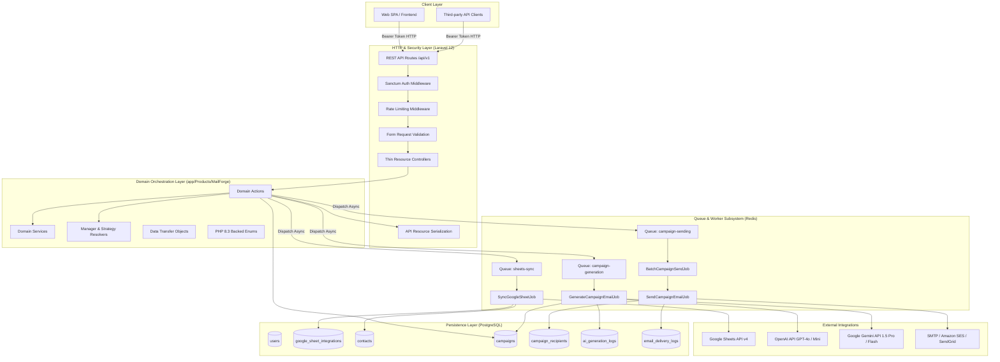
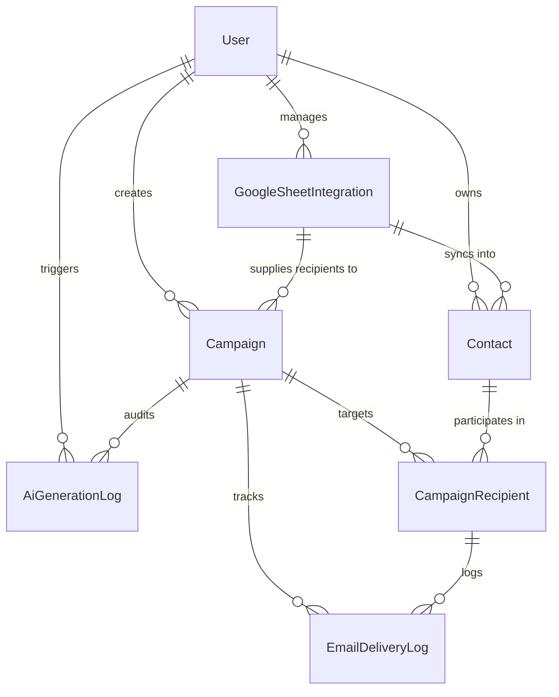

# MailForge AI — System Architecture & Technical Specification

> **Version:** 1.0.0  
> **Target Framework:** Laravel 12.x (PHP 8.3+)  
> **Database:** PostgreSQL 16+  
> **Queue & Cache:** Redis 7+  
> **Domain:** AI-Powered Email Campaign & Google Sheets Contact Synchronization Platform  

---

## 1. Executive Summary & System Vision

**MailForge AI** is a production-grade, enterprise-ready email campaign and contact synchronization backend built on **Laravel 12**. Designed with a modular, Domain-Driven Design (DDD) inspired service architecture, MailForge AI decouples external providers (Google Sheets API, OpenAI, Google Gemini, SMTP/SES/SendGrid) behind robust abstractions.

### Core Value Drivers:
1. **Automated Contact Ingestion:** Frictionless, continuous synchronization of contacts from Google Sheets into PostgreSQL with flexible schema mapping and custom JSON data capture.
2. **Pluggable AI Copywriting Engine:** Provider-agnostic AI layer supporting **OpenAI** and **Google Gemini** for prompt-to-email generation, rough-draft polishing, and copy rewriting.
3. **Safe Multi-Phase Campaign Lifecycle:** Mandatory Draft → AI Generation → Preview & Human Review → Approval → Queue Dispatch → Monitored Delivery pipeline, safeguarding against accidental bulk sends.
4. **Resilient Asynchronous Delivery:** Non-blocking, rate-limited, idempotent email dispatching via Redis queues with granular per-recipient status tracking, retry backoffs, and structured failure diagnostics.
5. **SaaS-Ready Foundation:** Clean modular directory structure (`app/Products/MailForge/`), strict API-first design, token authentication (Sanctum), and tenant/user boundary isolation.

---

## 2. Current Repository State & Gap Analysis

### 2.1 Workspace Inspection Findings
- **Laravel Framework:** Version `12.69.3`
- **PHP Environment:** `PHP 8.3.33 (cli)` with `pdo_pgsql`, `pgsql`, `curl`, `mbstring`, `openssl`, `bcmath`, and `zip` enabled.
- **Application Structure:** Standard Laravel 12 minimal skeleton:
  - `bootstrap/app.php` uses the modern Laravel 12 routing and middleware configuration builder.
  - Standard `routes/web.php` and `routes/console.php` are present; `routes/api.php` needs registration.
  - Default `.env` is configured for SQLite and database queues. Must be updated to PostgreSQL and Redis.
  - Test runner: PHPUnit 11.5 is pre-configured and passing.

### 2.2 Dependency & Architecture Gaps to Bridge
| Component | Existing State | Target Architecture Requirement |
| :--- | :--- | :--- |
| **Database** | SQLite default in `.env` | PostgreSQL 16 with JSONB and indexed foreign constraints |
| **API Layer** | No API routes registered | REST API v1 registered via `bootstrap/app.php` with Laravel Sanctum |
| **Domain Layer** | Default `app/Models/User.php` only | Modular `app/Products/MailForge/` domain with Actions, DTOs, Enums, Repositories |
| **Google Sheets** | None | `GoogleSheetsService` with Google API Client & column auto-mapping |
| **AI Providers** | None | `AIEmailManager` with `OpenAIEmailProvider` and `GeminiEmailProvider` |
| **Queue System** | `QUEUE_CONNECTION=database` | `QUEUE_CONNECTION=redis` with dedicated queues (`sheets-sync`, `campaign-generation`, `campaign-sending`) |
| **Email Delivery** | `MAIL_MAILER=log` | `EmailDeliveryManager` wrapping Laravel Mail + extensible API drivers |

---

## 3. High-Level System Architecture & Component Diagram



---

## 4. Final Folder & Module Structure

The project implements a **Modular Domain Architecture** located in `app/Products/MailForge/`, keeping domain logic strictly separated from HTTP presentation concerns.

```
app/
├── Http/
│   ├── Controllers/
│   │   └── Api/
│   │       └── V1/
│   │           ├── AuthController.php
│   │           ├── ContactController.php
│   │           ├── GoogleSheetIntegrationController.php
│   │           ├── CampaignController.php
│   │           ├── CampaignAiController.php
│   │           ├── CampaignRecipientController.php
│   │           └── SystemStatusController.php
│   ├── Requests/
│   │   └── Api/
│   │       └── V1/
│   │           ├── Contact/
│   │           │   ├── StoreContactRequest.php
│   │           │   └── UpdateContactRequest.php
│   │           ├── GoogleSheet/
│   │           │   ├── StoreIntegrationRequest.php
│   │           │   └── TriggerSyncRequest.php
│   │           └── Campaign/
│   │               ├── StoreCampaignRequest.php
│   │               ├── UpdateCampaignRequest.php
│   │               ├── GenerateCampaignContentRequest.php
│   │               ├── ApproveCampaignRequest.php
│   │               └── DispatchCampaignRequest.php
│   └── Resources/
│       └── Api/
│           └── V1/
│               ├── ContactResource.php
│               ├── GoogleSheetIntegrationResource.php
│               ├── CampaignResource.php
│               ├── CampaignRecipientResource.php
│               └── AiGenerationLogResource.php
├── Models/
│   └── User.php                              # Core authentication model
└── Products/
    └── MailForge/
        ├── Actions/                          # Single Responsibility Business Actions
        │   ├── Contact/
        │   │   ├── UpsertContactAction.php
        │   │   └── BatchUpsertContactsAction.php
        │   ├── GoogleSheet/
        │   │   ├── TestSheetConnectionAction.php
        │   │   ├── SyncContactsFromSheetAction.php
        │   │   └── ParseSheetRowAction.php
        │   ├── Campaign/
        │   │   ├── CreateCampaignAction.php
        │   │   ├── UpdateCampaignAction.php
        │   │   ├── AttachRecipientsToCampaignAction.php
        │   │   ├── ApproveCampaignAction.php
        │   │   ├── PauseCampaignAction.php
        │   │   └── CancelCampaignAction.php
        │   ├── Ai/
        │   │   ├── ProcessCampaignAiContentAction.php
        │   │   └── PreviewAiEmailAction.php
        │   └── Delivery/
        │       ├── DispatchCampaignSendingAction.php
        │       ├── DeliverRecipientEmailAction.php
        │       └── MarkRecipientFailedAction.php
        ├── Contracts/                        # Abstraction Interfaces
        │   ├── AIEmailProviderInterface.php
        │   ├── GoogleSheetsServiceInterface.php
        │   ├── EmailDeliveryServiceInterface.php
        │   ├── ContactRepositoryInterface.php
        │   ├── CampaignRepositoryInterface.php
        │   └── CampaignRecipientRepositoryInterface.php
        ├── DTOs/                             # Strongly Typed Data Transfer Objects
        │   ├── ContactData.php
        │   ├── SheetMappingConfig.php
        │   ├── SheetSyncResult.php
        │   ├── AiPromptPayload.php
        │   ├── AiGeneratedEmail.php
        │   ├── EmailMessagePayload.php
        │   └── DeliveryResult.php
        ├── Enums/                            # PHP 8.3 Backed Enums
        │   ├── CampaignStatus.php
        │   ├── RecipientDeliveryStatus.php
        │   ├── EmailMode.php
        │   ├── AiProviderType.php
        │   ├── ContactSourceType.php
        │   └── SyncStatus.php
        ├── Events/                           # Domain Events
        │   ├── SheetSyncCompleted.php
        │   ├── SheetSyncFailed.php
        │   ├── CampaignAiGenerated.php
        │   ├── CampaignApproved.php
        │   ├── CampaignSendingStarted.php
        │   ├── CampaignSendingCompleted.php
        │   ├── RecipientEmailSent.php
        │   └── RecipientEmailFailed.php
        ├── Exceptions/                       # Domain Exceptions
        │   ├── GoogleSheetSyncException.php
        │   ├── AiProviderException.php
        │   ├── CampaignInvalidStateTransitionException.php
        │   └── EmailDeliveryException.php
        ├── Jobs/                             # Queued Background Jobs
        │   ├── SyncGoogleSheetJob.php
        │   ├── GenerateCampaignEmailJob.php
        │   ├── BatchCampaignSendJob.php
        │   └── SendCampaignEmailJob.php
        ├── Listeners/                        # Event Listeners
        │   ├── LogCampaignLifecycleEvent.php
        │   └── UpdateCampaignProgressCounters.php
        ├── Models/                           # Eloquent Domain Models
        │   ├── GoogleSheetIntegration.php
        │   ├── Contact.php
        │   ├── Campaign.php
        │   ├── CampaignRecipient.php
        │   ├── AiGenerationLog.php
        │   └── EmailDeliveryLog.php
        ├── Policies/                         # Authorization Policies
        │   ├── CampaignPolicy.php
        │   ├── ContactPolicy.php
        │   └── GoogleSheetIntegrationPolicy.php
        ├── Providers/                        # Domain Service Providers
        │   └── MailForgeServiceProvider.php
        ├── Repositories/                     # Data Access Layer
        │   ├── ContactRepository.php
        │   ├── CampaignRepository.php
        │   └── CampaignRecipientRepository.php
        ├── Services/                         # Concrete Services & Drivers
        │   ├── GoogleSheets/
        │   │   ├── GoogleSheetsService.php
        │   │   └── SheetDataValidator.php
        │   ├── AI/
        │   │   ├── AIEmailManager.php        # Manager / Driver Factory
        │   │   ├── Providers/
        │   │   │   ├── OpenAIEmailProvider.php
        │   │   │   ├── GeminiEmailProvider.php
        │   │   │   └── MockAIEmailProvider.php
        │   │   └── Prompts/
        │   │       ├── EmailCopyPromptBuilder.php
        │   │       └── ToneStylePresets.php
        │   └── Delivery/
        │       ├── EmailDeliveryManager.php  # Manager / Driver Factory
        │       └── Providers/
        │           ├── LaravelMailDeliveryService.php
        │           └── MockEmailDeliveryService.php
        └── Support/                          # Domain Utilities & Helpers
            ├── EmailTemplateSanitizer.php
            └── RateLimitKeyGenerator.php
```

---

## 5. Database Schema & PostgreSQL Specifications

The database schema leverages PostgreSQL native features: **UUIDs / BigInt primary keys**, **JSONB** for arbitrary contact properties and payload snapshots, strict foreign key cascades, and compound B-tree indexes for high-throughput queue polling.

### 5.1 Tables & Schema Definitions

#### `users`
Standard Laravel user table with API token support (Sanctum).
```sql
CREATE TABLE users (
    id BIGSERIAL PRIMARY KEY,
    name VARCHAR(255) NOT NULL,
    email VARCHAR(255) NOT NULL UNIQUE,
    email_verified_at TIMESTAMPTZ NULL,
    password VARCHAR(255) NOT NULL,
    remember_token VARCHAR(100) NULL,
    created_at TIMESTAMPTZ NOT NULL DEFAULT NOW(),
    updated_at TIMESTAMPTZ NOT NULL DEFAULT NOW()
);
```

#### `google_sheet_integrations`
Stores Google Sheets connection profiles, credentials reference, worksheet metadata, and column mapping rules.
```sql
CREATE TABLE google_sheet_integrations (
    id BIGSERIAL PRIMARY KEY,
    user_id BIGINT NOT NULL REFERENCES users(id) ON DELETE CASCADE,
    name VARCHAR(255) NOT NULL,
    spreadsheet_id VARCHAR(255) NOT NULL,
    sheet_name VARCHAR(100) NOT NULL DEFAULT 'Sheet1',
    header_row INTEGER NOT NULL DEFAULT 1,
    column_mapping JSONB NOT NULL,               -- e.g. {"email": "B", "first_name": "A", "company": "C"}
    credentials_path VARCHAR(255) NULL,          -- Path or secret vault reference
    sync_status VARCHAR(50) NOT NULL DEFAULT 'idle', -- idle, syncing, completed, failed
    last_synced_at TIMESTAMPTZ NULL,
    last_error_message TEXT NULL,
    total_synced_contacts INTEGER NOT NULL DEFAULT 0,
    created_at TIMESTAMPTZ NOT NULL DEFAULT NOW(),
    updated_at TIMESTAMPTZ NOT NULL DEFAULT NOW(),
    deleted_at TIMESTAMPTZ NULL
);
CREATE INDEX idx_sheet_integrations_user ON google_sheet_integrations(user_id);
CREATE INDEX idx_sheet_integrations_sync_status ON google_sheet_integrations(sync_status);
```

#### `contacts`
Central recipient database. Supports arbitrary spreadsheet columns stored losslessly in `custom_data` JSONB.
```sql
CREATE TABLE contacts (
    id BIGSERIAL PRIMARY KEY,
    user_id BIGINT NOT NULL REFERENCES users(id) ON DELETE CASCADE,
    external_id VARCHAR(255) NULL,               -- Row index or external identifier from source
    first_name VARCHAR(150) NULL,
    last_name VARCHAR(150) NULL,
    full_name VARCHAR(300) NULL,
    email VARCHAR(255) NOT NULL,
    company VARCHAR(255) NULL,
    job_title VARCHAR(255) NULL,
    phone VARCHAR(50) NULL,
    custom_data JSONB NOT NULL DEFAULT '{}'::jsonb, -- Arbitrary sheet columns
    source VARCHAR(50) NOT NULL DEFAULT 'manual',   -- google_sheets, manual, csv, api
    source_reference VARCHAR(255) NULL,            -- e.g. spreadsheet_id or sheet_integration_id
    is_active BOOLEAN NOT NULL DEFAULT TRUE,
    created_at TIMESTAMPTZ NOT NULL DEFAULT NOW(),
    updated_at TIMESTAMPTZ NOT NULL DEFAULT NOW(),
    deleted_at TIMESTAMPTZ NULL,
    CONSTRAINT uq_contacts_user_email UNIQUE (user_id, email)
);
CREATE INDEX idx_contacts_user_id ON contacts(user_id);
CREATE INDEX idx_contacts_email ON contacts(email);
CREATE INDEX idx_contacts_source ON contacts(source, source_reference);
CREATE INDEX idx_contacts_is_active ON contacts(is_active);
CREATE INDEX idx_contacts_custom_data ON contacts USING GIN (custom_data);
```

#### `campaigns`
Campaign entities representing the marketing or outreach effort, AI copywriting settings, lifecycle status, and aggregated delivery metrics.
```sql
CREATE TABLE campaigns (
    id BIGSERIAL PRIMARY KEY,
    user_id BIGINT NOT NULL REFERENCES users(id) ON DELETE CASCADE,
    name VARCHAR(255) NOT NULL,
    subject VARCHAR(500) NULL,                   -- Can be populated directly or by AI
    source_type VARCHAR(50) NOT NULL DEFAULT 'all_contacts', -- all_contacts, google_sheet, contact_ids
    source_reference VARCHAR(255) NULL,          -- e.g. google_sheet_integration_id
    email_mode VARCHAR(50) NOT NULL,             -- direct, generate, polish
    ai_provider VARCHAR(50) NULL,                -- openai, gemini
    ai_prompt TEXT NULL,                         -- Instruction prompt or rough draft
    raw_input_email TEXT NULL,                   -- Original user rough draft (if polish mode)
    email_body TEXT NULL,                        -- Approved / active email body (HTML or Markdown)
    email_body_text TEXT NULL,                   -- Plain text fallback
    status VARCHAR(50) NOT NULL DEFAULT 'draft', -- draft, generating, review, approved, queued, sending, completed, paused, cancelled, failed
    scheduled_at TIMESTAMPTZ NULL,
    approved_at TIMESTAMPTZ NULL,
    started_at TIMESTAMPTZ NULL,
    completed_at TIMESTAMPTZ NULL,
    total_recipients INTEGER NOT NULL DEFAULT 0,
    sent_count INTEGER NOT NULL DEFAULT 0,
    failed_count INTEGER NOT NULL DEFAULT 0,
    created_at TIMESTAMPTZ NOT NULL DEFAULT NOW(),
    updated_at TIMESTAMPTZ NOT NULL DEFAULT NOW(),
    deleted_at TIMESTAMPTZ NULL
);
CREATE INDEX idx_campaigns_user_id ON campaigns(user_id);
CREATE INDEX idx_campaigns_status ON campaigns(status);
CREATE INDEX idx_campaigns_scheduled_at ON campaigns(scheduled_at);
```

#### `campaign_recipients`
Granular delivery layer decoupling contacts from campaign instances. Prevents duplicate sends and tracks independent delivery states.
```sql
CREATE TABLE campaign_recipients (
    id BIGSERIAL PRIMARY KEY,
    campaign_id BIGINT NOT NULL REFERENCES campaigns(id) ON DELETE CASCADE,
    contact_id BIGINT NOT NULL REFERENCES contacts(id) ON DELETE CASCADE,
    email VARCHAR(255) NOT NULL,
    subject VARCHAR(500) NOT NULL,
    personalized_body TEXT NOT NULL,             -- Merged personalized template body
    status VARCHAR(50) NOT NULL DEFAULT 'draft', -- draft, queued, processing, sent, failed, cancelled
    queued_at TIMESTAMPTZ NULL,
    sent_at TIMESTAMPTZ NULL,
    failed_at TIMESTAMPTZ NULL,
    error_message TEXT NULL,
    attempts INTEGER NOT NULL DEFAULT 0,
    provider_message_id VARCHAR(255) NULL,       -- Message-ID from SMTP/SES/SendGrid
    custom_attributes JSONB NOT NULL DEFAULT '{}'::jsonb,
    created_at TIMESTAMPTZ NOT NULL DEFAULT NOW(),
    updated_at TIMESTAMPTZ NOT NULL DEFAULT NOW(),
    CONSTRAINT uq_campaign_recipient UNIQUE (campaign_id, contact_id)
);
CREATE INDEX idx_recipients_campaign_id ON campaign_recipients(campaign_id);
CREATE INDEX idx_recipients_contact_id ON campaign_recipients(contact_id);
CREATE INDEX idx_recipients_status ON campaign_recipients(status);
CREATE INDEX idx_recipients_campaign_status ON campaign_recipients(campaign_id, status);
CREATE INDEX idx_recipients_email ON campaign_recipients(email);
```

#### `ai_generation_logs`
Audit log tracking AI prompts, responses, token usage, latency, and provider diagnostics.
```sql
CREATE TABLE ai_generation_logs (
    id BIGSERIAL PRIMARY KEY,
    campaign_id BIGINT NULL REFERENCES campaigns(id) ON DELETE SET NULL,
    user_id BIGINT NOT NULL REFERENCES users(id) ON DELETE CASCADE,
    provider VARCHAR(50) NOT NULL,               -- openai, gemini
    model VARCHAR(100) NOT NULL,                -- gpt-4o, gemini-1.5-pro, etc.
    operation VARCHAR(50) NOT NULL,             -- generate, polish, rewrite
    prompt_tokens INTEGER NULL,
    completion_tokens INTEGER NULL,
    total_tokens INTEGER NULL,
    duration_ms INTEGER NOT NULL,
    status VARCHAR(50) NOT NULL,                -- success, error
    error_message TEXT NULL,
    raw_prompt TEXT NOT NULL,
    raw_response TEXT NULL,
    created_at TIMESTAMPTZ NOT NULL DEFAULT NOW()
);
CREATE INDEX idx_ai_logs_campaign_id ON ai_generation_logs(campaign_id);
CREATE INDEX idx_ai_logs_user_id ON ai_generation_logs(user_id);
CREATE INDEX idx_ai_logs_provider ON ai_generation_logs(provider);
```

#### `email_delivery_logs`
Detailed transmission audit log capturing delivery attempts, SMTP response codes, and network exceptions.
```sql
CREATE TABLE email_delivery_logs (
    id BIGSERIAL PRIMARY KEY,
    campaign_recipient_id BIGINT NOT NULL REFERENCES campaign_recipients(id) ON DELETE CASCADE,
    campaign_id BIGINT NOT NULL REFERENCES campaigns(id) ON DELETE CASCADE,
    provider VARCHAR(50) NOT NULL,               -- smtp, ses, mailgun
    status VARCHAR(50) NOT NULL,                -- sent, failed, retrying
    response_code VARCHAR(50) NULL,
    provider_response TEXT NULL,
    attempt INTEGER NOT NULL,
    created_at TIMESTAMPTZ NOT NULL DEFAULT NOW()
);
CREATE INDEX idx_deliv_logs_recipient ON email_delivery_logs(campaign_recipient_id);
CREATE INDEX idx_deliv_logs_campaign ON email_delivery_logs(campaign_id);
```

---

## 6. Model Relationships



### Eloquent Model Associations
- **`User`**:
  - `hasMany(GoogleSheetIntegration::class)`
  - `hasMany(Contact::class)`
  - `hasMany(Campaign::class)`
  - `hasMany(AiGenerationLog::class)`
- **`GoogleSheetIntegration`**:
  - `belongsTo(User::class)`
  - `hasMany(Contact::class, 'source_reference', 'id')`
- **`Contact`**:
  - `belongsTo(User::class)`
  - `hasMany(CampaignRecipient::class)`
  - `belongsToMany(Campaign::class, 'campaign_recipients')`
- **`Campaign`**:
  - `belongsTo(User::class)`
  - `belongsTo(GoogleSheetIntegration::class, 'source_reference')`
  - `hasMany(CampaignRecipient::class)`
  - `hasMany(AiGenerationLog::class)`
  - `hasMany(EmailDeliveryLog::class)`
- **`CampaignRecipient`**:
  - `belongsTo(Campaign::class)`
  - `belongsTo(Contact::class)`
  - `hasMany(EmailDeliveryLog::class)`

---

## 7. PHP 8.3 Backed Enums & State Management

Using backed enums guarantees strict type safety throughout database columns, DTOs, and API responses.

```php
namespace App\Products\MailForge\Enums;

enum CampaignStatus: string
{
    case DRAFT = 'draft';
    case GENERATING = 'generating';
    case REVIEW = 'review';
    case APPROVED = 'approved';
    case QUEUED = 'queued';
    case SENDING = 'sending';
    case COMPLETED = 'completed';
    case PAUSED = 'paused';
    case CANCELLED = 'cancelled';
    case FAILED = 'failed';

    public function canEdit(): bool
    {
        return in_array($this, [self::DRAFT, self::REVIEW]);
    }

    public function canApprove(): bool
    {
        return in_array($this, [self::DRAFT, self::REVIEW]);
    }

    public function canDispatch(): bool
    {
        return $this === self::APPROVED;
    }
}

enum RecipientDeliveryStatus: string
{
    case DRAFT = 'draft';
    case QUEUED = 'queued';
    case PROCESSING = 'processing';
    case SENT = 'sent';
    case FAILED = 'failed';
    case CANCELLED = 'cancelled';
}

enum EmailMode: string
{
    case DIRECT = 'direct';     // User supplies finalized subject & body
    case GENERATE = 'generate'; // User supplies prompt -> AI creates subject & body
    case POLISH = 'polish';     // User supplies rough draft -> AI refines & enhances
}

enum AiProviderType: string
{
    case OPENAI = 'openai';
    case GEMINI = 'gemini';
    case MOCK = 'mock';
}

enum SyncStatus: string
{
    case IDLE = 'idle';
    case SYNCING = 'syncing';
    case COMPLETED = 'completed';
    case FAILED = 'failed';
}
```

---

## 8. Service & Provider Architecture

### 8.1 AI Email Generation Subsystem (Strategy / Manager Pattern)

The application avoids hardcoding OpenAI or Gemini API calls in business logic by implementing an extensible Manager pattern built on Laravel's `Illuminate\Support\Manager`.

```
                    ┌──────────────────────────────┐
                    │  AIEmailProviderInterface    │
                    └──────────────┬───────────────┘
                                   │
         ┌─────────────────────────┼─────────────────────────┐
         │                         │                         │
┌────────┴──────────────┐ ┌────────┴──────────────┐ ┌────────┴──────────────┐
│  OpenAIEmailProvider  │ │  GeminiEmailProvider  │ │  MockAIEmailProvider  │
└───────────────────────┘ └───────────────────────┘ └───────────────────────┘
         ▲                         ▲                         ▲
         └─────────────────────────┼─────────────────────────┘
                                   │
                    ┌──────────────┴───────────────┐
                    │      AIEmailManager          │ (Resolves active driver via config)
                    └──────────────┬───────────────┘
                                   │
                    ┌──────────────┴───────────────┐
                    │ ProcessCampaignAiContentAction│
                    └──────────────────────────────┘
```

#### Contract: `AIEmailProviderInterface.php`
```php
namespace App\Products\MailForge\Contracts;

use App\Products\MailForge\DTOs\AiPromptPayload;
use App\Products\MailForge\DTOs\AiGeneratedEmail;

interface AIEmailProviderInterface
{
    /**
     * Generate an email subject and body from an instructional prompt.
     */
    public function generateEmail(AiPromptPayload $payload): AiGeneratedEmail;

    /**
     * Polish and refine a rough user draft into a professional email.
     */
    public function polishEmail(AiPromptPayload $payload): AiGeneratedEmail;

    /**
     * Rewrite an existing email with an alternate tone or structure.
     */
    public function rewriteEmail(AiPromptPayload $payload): AiGeneratedEmail;

    /**
     * Get the provider's unique identifier.
     */
    public function getName(): string;
}
```

#### DTOs: `AiPromptPayload.php` & `AiGeneratedEmail.php`
```php
namespace App\Products\MailForge\DTOs;

readonly class AiPromptPayload
{
    public function __construct(
        public string $prompt,
        public ?string $roughDraft = null,
        public ?string $tone = 'professional',
        public ?string $targetAudience = null,
        public ?string $keyPoints = null,
        public array $contextVariables = [],
        public array $options = []
    ) {}
}

readonly class AiGeneratedEmail
{
    public function __construct(
        public string $subject,
        public string $bodyHtml,
        public string $bodyText,
        public string $provider,
        public string $model,
        public int $promptTokens,
        public int $completionTokens,
        public int $totalTokens,
        public int $durationMs
    ) {}
}
```

#### Concrete Driver 1: `OpenAIEmailProvider.php`
- Uses Laravel's `Http::baseUrl('https://api.openai.com/v1')` with Bearer authentication and exponential retry backoff.
- Utilizes Structured Outputs (JSON Schema / `response_format: { type: "json_object" }`) ensuring the model always returns deterministic `{ "subject": "...", "body_html": "...", "body_text": "..." }`.
- Captures token usage metadata (`usage.prompt_tokens`, `usage.completion_tokens`) for database audit logging.

#### Concrete Driver 2: `GeminiEmailProvider.php`
- Uses Google Gemini REST API endpoint `https://generativelanguage.googleapis.com/v1beta/models/{model}:generateContent?key={apiKey}`.
- Configures `response_mime_type: "application/json"` with schema definition.
- Automatically records Gemini usage metadata (`usageMetadata.promptTokenCount`, `usageMetadata.candidatesTokenCount`).

#### Factory: `AIEmailManager.php`
```php
namespace App\Products\MailForge\Services\AI;

use Illuminate\Support\Manager;
use App\Products\MailForge\Contracts\AIEmailProviderInterface;

class AIEmailManager extends Manager
{
    public function getDefaultDriver(): string
    {
        return config('mailforge.ai.default_provider', 'openai');
    }

    public function createOpenaiDriver(): AIEmailProviderInterface
    {
        return new Providers\OpenAIEmailProvider(
            apiKey: config('mailforge.ai.providers.openai.api_key'),
            model: config('mailforge.ai.providers.openai.model', 'gpt-4o-mini'),
            timeout: config('mailforge.ai.providers.openai.timeout', 30)
        );
    }

    public function createGeminiDriver(): AIEmailProviderInterface
    {
        return new Providers\GeminiEmailProvider(
            apiKey: config('mailforge.ai.providers.gemini.api_key'),
            model: config('mailforge.ai.providers.gemini.model', 'gemini-1.5-flash'),
            timeout: config('mailforge.ai.providers.gemini.timeout', 30)
        );
    }

    public function createMockDriver(): AIEmailProviderInterface
    {
        return new Providers\MockAIEmailProvider();
    }
}
```

---

### 8.2 Google Sheets Integration Subsystem

The Google Sheets integration handles service account authentication, spreadsheet reading, column mapping, data normalization, duplicate contact resolution, and synchronization metrics.

#### Contract: `GoogleSheetsServiceInterface.php`
```php
namespace App\Products\MailForge\Contracts;

use App\Products\MailForge\DTOs\SheetMappingConfig;
use App\Products\MailForge\DTOs\SheetSyncResult;
use App\Products\MailForge\Models\GoogleSheetIntegration;

interface GoogleSheetsServiceInterface
{
    /**
     * Test credentials and read sheet metadata.
     */
    public function testConnection(string $spreadsheetId, ?string $credentialsPath = null): bool;

    /**
     * Retrieve header column names from the designated header row.
     */
    public function getHeaders(string $spreadsheetId, string $sheetName = 'Sheet1', int $headerRow = 1): array;

    /**
     * Synchronize contacts into PostgreSQL database in batched chunks.
     */
    public function sync(GoogleSheetIntegration $integration): SheetSyncResult;
}
```

#### Sync Architecture & Conflict Resolution:
1. **Google Sheets Service Account Auth:** Authenticates via Google API Client (`Google\Client`) scoped to `https://www.googleapis.com/auth/spreadsheets.readonly`.
2. **Column Auto-Mapper & Validation:**
   - Evaluates configured mapping rules (e.g. `First Name` -> `first_name`, `Work Email` -> `email`).
   - Normalizes and validates emails using `filter_var($email, FILTER_VALIDATE_EMAIL)`.
   - Captures all non-mapped row headers into the contact's `custom_data` JSONB column.
3. **Idempotent Upsert Strategy:**
   - Contacts are uniquely keyed by `(user_id, email)`.
   - Existing contacts are updated (preserving existing custom data through JSONB merge `jsonb_concat`); new contacts are inserted.
   - Rows missing valid email addresses are tracked as skipped/invalid without halting the overall batch.

---

### 8.3 Email Delivery Subsystem

```
                    ┌──────────────────────────────────┐
                    │  EmailDeliveryServiceInterface   │
                    └────────────────┬─────────────────┘
                                     │
         ┌───────────────────────────┴───────────────────────────┐
         │                                                       │
┌────────┴─────────────────────────┐   ┌─────────────────────────┴─────────────────────┐
│   LaravelMailDeliveryService     │   │      MockEmailDeliveryService (Testing)       │
│ (Wraps SMTP, SES, Mailgun, Log)  │   └───────────────────────────────────────────────┘
└──────────────────────────────────┘
```

#### Contract: `EmailDeliveryServiceInterface.php`
```php
namespace App\Products\MailForge\Contracts;

use App\Products\MailForge\DTOs\DeliveryResult;
use App\Products\MailForge\Models\CampaignRecipient;

interface EmailDeliveryServiceInterface
{
    /**
     * Transmit the personalized campaign email to the recipient.
     */
    public function send(CampaignRecipient $recipient): DeliveryResult;

    /**
     * Provider driver identifier.
     */
    public function getName(): string;
}
```

#### Features:
- **Template Variable Personalization:** Merges contact tags like `{{first_name}}`, `{{company}}`, `{{custom_data.attribute}}` safely into subject and body before dispatch.
- **Delivery Logging:** Every send attempt logs provider message IDs, network response codes, and timestamps into `email_delivery_logs`.

---

## 9. Asynchronous Queue & Background Job Architecture

To ensure strict zero-blocking HTTP operations, all resource-intensive workloads are offloaded to Redis-backed queues.

```mermaid
sequenceDiagram
    autonumber
    actor User as User / API Client
    participant API as Laravel API (HTTP)
    participant Redis as Redis Queue (Delayed/Active)
    participant Worker as Queue Workers
    participant Ext as External APIs (Sheets / AI / SMTP)
    participant DB as PostgreSQL Database

    Note over User,DB: Phase 1: Google Sheet Contact Sync
    User->>API: POST /api/v1/google-sheets/{id}/sync
    API->>DB: Set status = 'syncing'
    API->>Redis: Dispatch SyncGoogleSheetJob (queue: sheets-sync)
    API-->>User: 202 Accepted (Sync queued)
    Worker->>Redis: Pop SyncGoogleSheetJob
    Worker->>Ext: Google Sheets API v4 (Fetch Rows)
    Worker->>DB: Batch upsert contacts & update metrics
    Worker->>DB: Set status = 'completed'

    Note over User,DB: Phase 2: AI Email Generation
    User->>API: POST /api/v1/campaigns/{id}/generate-content
    API->>DB: Set status = 'generating'
    API->>Redis: Dispatch GenerateCampaignEmailJob (queue: campaign-generation)
    API-->>User: 202 Accepted (Generation in progress)
    Worker->>Redis: Pop GenerateCampaignEmailJob
    Worker->>Ext: OpenAI or Gemini API
    Worker->>DB: Store subject & body; Set status = 'review'
    Worker->>DB: Log token metrics in ai_generation_logs

    Note over User,DB: Phase 3: Preview, Approval & Safe Send
    User->>API: GET /api/v1/campaigns/{id} (Preview generated draft)
    User->>API: POST /api/v1/campaigns/{id}/approve
    API->>DB: Set status = 'approved'
    User->>API: POST /api/v1/campaigns/{id}/send
    API->>DB: Set status = 'queued'
    API->>Redis: Dispatch BatchCampaignSendJob (queue: campaign-sending)
    API-->>User: 202 Accepted (Campaign sending initiated)
    Worker->>Redis: Pop BatchCampaignSendJob
    Worker->>DB: Query campaign_recipients in chunks of 100
    loop For Each Recipient
        Worker->>Redis: Dispatch SendCampaignEmailJob (queue: campaign-sending)
    end
    Worker->>Redis: Pop SendCampaignEmailJob
    Worker->>DB: Lock recipient & set status = 'processing'
    Worker->>Ext: SMTP / Laravel Mail
    alt Delivery Succeeded
        Worker->>DB: Update recipient: status='sent', sent_at=NOW()
        Worker->>DB: Increment campaign sent_count
    else Transient Failure
        Worker->>Redis: Release back to queue with exponential backoff
    else Max Retries Exceeded
        Worker->>DB: Update recipient: status='failed', error_message=...
        Worker->>DB: Increment campaign failed_count
    end
```

### 9.1 Dedicated Queues & Worker Isolation
| Queue Name | Responsibilities | Concurrency / Worker Tuning | Rate Limits |
| :--- | :--- | :--- | :--- |
| `sheets-sync` | Google Sheet API row fetching and bulk DB upserts | 2 workers | 60 requests/min (Google Sheets quota) |
| `campaign-generation` | OpenAI and Google Gemini prompt processing | 3 workers | Dynamic per AI tier (e.g. 500 RPM) |
| `campaign-sending` | Recipient batching & individual SMTP delivery | 5-10 workers | Configurable rate limiting (e.g. 100 emails/min) |

### 9.2 Resilience & Idempotency Rules
1. **Atomic Status Locking:** Before an email is transmitted, `SendCampaignEmailJob` executes an atomic database check:
   ```sql
   UPDATE campaign_recipients 
   SET status = 'processing', attempts = attempts + 1, updated_at = NOW() 
   WHERE id = ? AND status = 'queued';
   ```
   If 0 rows are affected (meaning another worker processed or cancelled it), the job terminates immediately, eliminating duplicate delivery.
2. **Exponential Backoff:** Transient network errors retry with exponential delays (`$backoff = [30, 120, 600]`).
3. **Hard Failure Logging:** If all retries fail (`$tries = 3`), `failed(Throwable $exception)` marks the recipient record as `failed`, records the stack message in `error_message`, and increments `campaigns.failed_count`.

---

## 10. REST API Specification

All endpoints reside under `/api/v1/`, authenticate via Bearer token (Sanctum), and emit standard JSON payloads with consistent pagination and error envelopes.

### 10.1 Authentication & Profile
- `POST /api/v1/auth/register` — Register a new user account.
- `POST /api/v1/auth/login` — Authenticate and receive Sanctum API Bearer token.
- `POST /api/v1/auth/logout` — Revoke active token.
- `GET /api/v1/auth/user` — Retrieve authenticated user profile.

### 10.2 Contacts Management
- `GET /api/v1/contacts` — Paginated contact list with search, active status, and source filters.
- `POST /api/v1/contacts` — Manually create a single contact.
- `GET /api/v1/contacts/{id}` — Retrieve single contact with custom data.
- `PUT /api/v1/contacts/{id}` — Update contact attributes.
- `DELETE /api/v1/contacts/{id}` — Soft-delete contact.

### 10.3 Google Sheets Synchronization
- `GET /api/v1/google-sheets` — List configured Google Sheet integrations.
- `POST /api/v1/google-sheets` — Register a Google Sheet with column mapping config.
- `GET /api/v1/google-sheets/{id}` — Get integration details and sync stats.
- `PUT /api/v1/google-sheets/{id}` — Update sheet name, header row, or mapping.
- `POST /api/v1/google-sheets/{id}/test-connection` — Test service account access to spreadsheet.
- `POST /api/v1/google-sheets/{id}/headers` — Fetch row 1 header labels to facilitate UI mapping.
- `POST /api/v1/google-sheets/{id}/sync` — Dispatch asynchronous sync job.
- `GET /api/v1/google-sheets/{id}/sync-status` — Polling endpoint for active sync progress.

### 10.4 AI Copywriting & Provider Diagnostics
- `GET /api/v1/ai/providers` — List supported providers (`openai`, `gemini`) and active default.
- `POST /api/v1/ai/preview` — Test-run prompt/rough draft generation synchronously without saving to a campaign.

### 10.5 Campaigns & Delivery Lifecycle
- `GET /api/v1/campaigns` — List campaigns with status, recipient counts, and progress percentages.
- `POST /api/v1/campaigns` — Create campaign (supports `direct`, `generate`, `polish` modes).
- `GET /api/v1/campaigns/{id}` — Retrieve campaign detail with subject, body, and status.
- `PUT /api/v1/campaigns/{id}` — Update campaign content (allowed only in `draft` or `review` status).
- `DELETE /api/v1/campaigns/{id}` — Soft delete campaign (if not active).
- `POST /api/v1/campaigns/{id}/generate-content` — Dispatch asynchronous AI generation job (`GenerateCampaignEmailJob`).
- `POST /api/v1/campaigns/{id}/approve` — Transition campaign from `draft`/`review` to `approved`.
- `POST /api/v1/campaigns/{id}/send` — Transition campaign to `queued` and dispatch `BatchCampaignSendJob`.
- `POST /api/v1/campaigns/{id}/pause` — Pause an ongoing campaign.
- `POST /api/v1/campaigns/{id}/cancel` — Cancel pending/queued recipient deliveries.
- `GET /api/v1/campaigns/{id}/recipients` — List campaign recipients with individual delivery statuses.
- `GET /api/v1/campaigns/{id}/stats` — Delivery performance metrics (sent, failed, pending, failure reasons).

---

## 11. Configuration & Environment Variables

### 11.1 Dedicated Configuration Files

#### `config/mailforge.php`
Central domain configuration for rate limits, defaults, and timeouts.
```php
return [
    'defaults' => [
        'email_mode' => 'direct',
        'rate_limit_per_minute' => 100,
        'batch_size' => 100,
    ],
    'ai' => [
        'default_provider' => env('AI_PROVIDER', 'openai'),
        'max_tokens' => env('AI_MAX_TOKENS', 1500),
        'temperature' => env('AI_TEMPERATURE', 0.7),
        'providers' => [
            'openai' => [
                'api_key' => env('OPENAI_API_KEY'),
                'organization' => env('OPENAI_ORGANIZATION'),
                'model' => env('OPENAI_MODEL', 'gpt-4o-mini'),
                'timeout' => env('OPENAI_TIMEOUT', 30),
            ],
            'gemini' => [
                'api_key' => env('GEMINI_API_KEY'),
                'model' => env('GEMINI_MODEL', 'gemini-1.5-flash'),
                'timeout' => env('GEMINI_TIMEOUT', 30),
            ],
        ],
    ],
    'google' => [
        'service_account_json_path' => env('GOOGLE_SERVICE_ACCOUNT_JSON'),
        'application_name' => env('GOOGLE_APPLICATION_NAME', 'MailForge AI'),
        'chunk_size' => env('GOOGLE_SHEETS_CHUNK_SIZE', 500),
    ],
    'delivery' => [
        'default_mailer' => env('MAIL_MAILER', 'smtp'),
        'max_retry_attempts' => env('MAILFORGE_MAX_RETRIES', 3),
        'retry_backoff_seconds' => [30, 120, 600],
    ],
];
```

### 11.2 Environment Variables (`.env.example`)
```ini
APP_NAME="MailForge AI"
APP_ENV=local
APP_KEY=
APP_DEBUG=true
APP_URL=http://localhost:8000

# Database (PostgreSQL)
DB_CONNECTION=pgsql
DB_HOST=127.0.0.1
DB_PORT=5432
DB_DATABASE=mailforge_ai
DB_USERNAME=postgres
DB_PASSWORD=secret

# Queue & Cache (Redis)
QUEUE_CONNECTION=redis
CACHE_STORE=redis
REDIS_CLIENT=phpredis
REDIS_HOST=127.0.0.1
REDIS_PASSWORD=null
REDIS_PORT=6379

# AI Providers Configuration
AI_PROVIDER=openai # openai | gemini
AI_MAX_TOKENS=1500
AI_TEMPERATURE=0.7

OPENAI_API_KEY=sk-proj-your-openai-api-key
OPENAI_MODEL=gpt-4o-mini
OPENAI_TIMEOUT=30

GEMINI_API_KEY=AIzaSyYourGeminiApiKey
GEMINI_MODEL=gemini-1.5-flash
GEMINI_TIMEOUT=30

# Google Sheets API Integration
GOOGLE_APPLICATION_NAME="MailForge AI"
GOOGLE_SERVICE_ACCOUNT_JSON=storage/app/google/service-account.json
GOOGLE_SHEETS_CHUNK_SIZE=500

# Email Delivery (Laravel Mail / SMTP)
MAIL_MAILER=smtp
MAIL_SCHEME=null
MAIL_HOST=smtp.mailtrap.io
MAIL_PORT=2525
MAIL_USERNAME=null
MAIL_PASSWORD=null
MAIL_FROM_ADDRESS="outreach@mailforge.ai"
MAIL_FROM_NAME="MailForge Outreach"

# MailForge Delivery Tuning
MAILFORGE_MAX_RETRIES=3
MAILFORGE_RATE_LIMIT_PER_MINUTE=120
```

---

## 12. Required Composer Packages

To ensure maximum maintainability and zero vendor lock-in, external dependencies are curated to industry standards:

```bash
# 1. API Token Authentication
composer require laravel/sanctum

# 2. Redis Client support
composer require predis/predis

# 3. Google API Client (Sheets v4)
composer require google/apiclient:^2.16

# 4. Dev & Testing
composer require pestphp/pest --dev --with-all-dependencies
composer require pestphp/pest-plugin-laravel --dev
```

*Note on AI Clients:* Using Laravel's native, highly optimized `Illuminate\Support\Facades\Http` client with typed DTOs for OpenAI and Google Gemini APIs provides complete control over timeouts, HTTP/2 multiplexing, JSON schema validation, retry policies, and error handling without depending on unstable third-party SDKs.

---

## 13. Security Considerations & Data Protection

1. **Zero Credential Exposure:**
   - OpenAI and Gemini API keys are never stored in the database or logged in application traces.
   - Google Service Account keys are stored either encrypted on disk or injected via secure environment variables.
2. **PII Masking & Structured Logging:**
   - Logging channels mask recipient emails, contact telephone numbers, and auth tokens.
   - Exceptions caught in queue jobs record error classification without exposing database credentials or SMTP auth packets.
3. **Prompt Injection Mitigation:**
   - System prompts are firmly separated from user instructions.
   - System prompt instructions strictly instruct the model to produce output exclusively in compliant JSON containing email copywriting fields, ignoring prompt escape instructions.
4. **Tenant & User Boundary Authorization:**
   - Every database query for contacts, campaigns, and sheets integrates a mandatory `user_id` scope.
   - Laravel Policies (`CampaignPolicy`, `ContactPolicy`, `GoogleSheetIntegrationPolicy`) enforce that users can never inspect or trigger campaigns belonging to other accounts.
5. **Rate Limiting & Anti-Spam:**
   - REST API rate limiting via `throttle:api` (60 requests per minute default).
   - AI generation throttling to prevent denial-of-wallet spikes.
   - Email sending concurrency caps to prevent SMTP server reputation blacklisting.

---

## 14. Testing Strategy & Quality Assurance Matrix

The platform will maintain a minimum of **85% test coverage** using Pest / PHPUnit test suites.

```
tests/
├── Unit/
│   ├── Enums/
│   │   ├── CampaignStatusTest.php
│   │   └── RecipientDeliveryStatusTest.php
│   ├── DTOs/
│   │   ├── SheetMappingConfigTest.php
│   │   └── AiPromptPayloadTest.php
│   ├── Services/
│   │   ├── OpenAIEmailProviderTest.php       (Http::fake)
│   │   ├── GeminiEmailProviderTest.php       (Http::fake)
│   │   ├── AIEmailManagerTest.php
│   │   └── EmailTemplateSanitizerTest.php
│   └── Support/
│       └── RateLimitKeyGeneratorTest.php
└── Feature/
    ├── Auth/
    │   └── AuthenticationTest.php
    ├── Contacts/
    │   ├── ContactCrudTest.php
    │   └── ContactDuplicateResolutionTest.php
    ├── GoogleSheets/
    │   ├── GoogleSheetConnectionTest.php
    │   └── GoogleSheetSyncJobTest.php
    ├── Campaigns/
    │   ├── CampaignLifecycleTest.php
    │   ├── CampaignAiGenerationJobTest.php
    │   ├── CampaignApprovalWorkflowTest.php
    │   └── CampaignDispatchingTest.php
    └── Delivery/
        ├── SendCampaignEmailJobTest.php      (Mail::fake)
        ├── EmailRetryAndBackoffTest.php
        └── EmailFailureLoggingTest.php
```

### Key Test Scenarios
- **Duplicate Contact Detection:** Verifies that importing the same email address updates the existing contact's attributes and merges `custom_data` rather than creating duplicates.
- **Provider Switching:** Verifies that changing `AI_PROVIDER=gemini` correctly invokes Gemini endpoints instead of OpenAI without any changes to controller or action code.
- **AI Preview & Approval Gate:** Verifies that campaigns generated via AI remain in `review` status and cannot be sent until an explicit `/approve` call is made.
- **Queue Idempotency:** Simulates concurrent workers picking up the same `campaign_recipient` and asserts that only one worker succeeds in sending the email.
- **Fault Tolerance:** Simulates SMTP 5xx failures, verifies that the job retries with backoff, and ensures permanent failure status is recorded when max retries are exceeded.

---

## 15. Implementation Phases & Execution Roadmap

### Phase 1: Architecture Blueprint & Planning (Completed)
- [x] Repository and environment inspection (Laravel 12.69.3, PHP 8.3.33).
- [x] Comprehensive architectural specification created (`ARCHITECTURE.md`).

### Phase 2: Foundation & Database Setup
- [ ] Configure PostgreSQL database connection and Redis cache/queue drivers in `.env`.
- [ ] Install required Composer packages (`laravel/sanctum`, `predis/predis`, `google/apiclient`).
- [ ] Publish Sanctum configuration and register API routing in `bootstrap/app.php`.
- [ ] Create database migrations for `google_sheet_integrations`, `contacts`, `campaigns`, `campaign_recipients`, `ai_generation_logs`, and `email_delivery_logs`.
- [ ] Create PHP 8.3 backed Enums (`CampaignStatus`, `RecipientDeliveryStatus`, `EmailMode`, `AiProviderType`, `SyncStatus`).
- [ ] Create Eloquent models with typed relationships, casts, and query scopes.

### Phase 3: External Integrations Abstraction
- [ ] Implement `AIEmailProviderInterface`, DTOs, and `AIEmailManager`.
- [ ] Implement `OpenAIEmailProvider` with structured JSON output and HTTP client retries.
- [ ] Implement `GeminiEmailProvider` with Gemini REST API client.
- [ ] Implement `MockAIEmailProvider` for local testing without incurring API costs.
- [ ] Implement `GoogleSheetsServiceInterface` and `GoogleSheetsService` with column auto-mapping and validation.
- [ ] Implement `EmailDeliveryServiceInterface` and `LaravelMailDeliveryService`.

### Phase 4: Business Actions & Background Queue Workers
- [ ] Implement Contact actions: `UpsertContactAction`, `BatchUpsertContactsAction`.
- [ ] Implement Google Sheet actions: `SyncContactsFromSheetAction`, `TestSheetConnectionAction`.
- [ ] Implement AI actions: `ProcessCampaignAiContentAction`, `PreviewAiEmailAction`.
- [ ] Implement Campaign actions: `CreateCampaignAction`, `ApproveCampaignAction`, `DispatchCampaignSendingAction`.
- [ ] Implement Queue jobs: `SyncGoogleSheetJob`, `GenerateCampaignEmailJob`, `BatchCampaignSendJob`, `SendCampaignEmailJob`.

### Phase 5: REST API Layer & Authorization
- [ ] Implement Form Requests with robust validation rules.
- [ ] Implement API Resources for clean JSON data transformation.
- [ ] Implement thin API Controllers under `app/Http/Controllers/Api/V1/`.
- [ ] Implement Laravel Policies (`CampaignPolicy`, `ContactPolicy`, etc.).
- [ ] Configure rate limiters in `bootstrap/app.php`.

### Phase 6: Automated Testing, Documentation & Developer Experience
- [ ] Write Unit and Feature test suites with mocks (`Http::fake`, `Mail::fake`, `Queue::fake`).
- [ ] Generate comprehensive `.env.example`.
- [ ] Create exhaustive `README.md` covering setup, queue workers, Redis configuration, API endpoints, and production deployment.
- [ ] Validate entire test suite execution with 100% pass rate.
