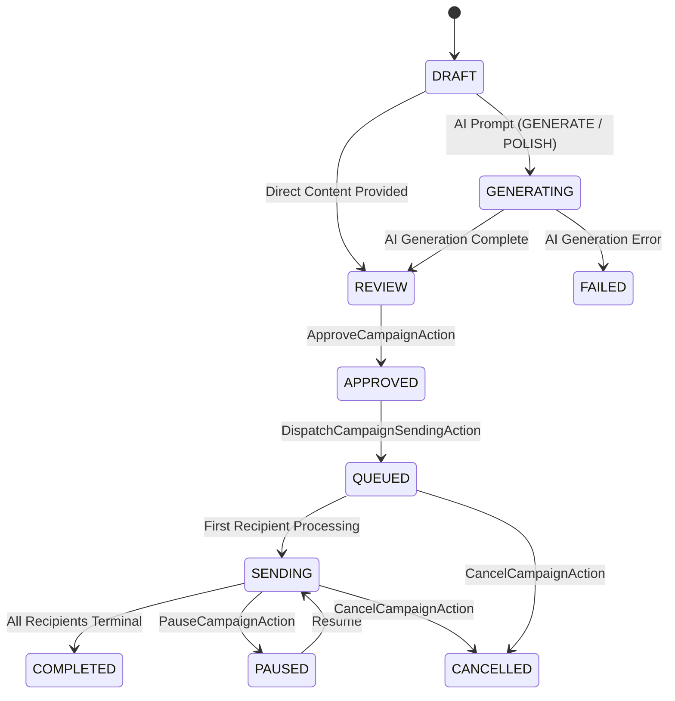

# MailForge AI

**MailForge AI** is an enterprise-grade, AI-powered email campaign and automation backend engine built with Laravel 12 (PHP 8.3+), PostgreSQL, and Redis.

The system allows users to upload contact spreadsheets (`.xlsx`, `.xls`, `.csv`), validates and ingests contacts with schema flexibility (`jsonb`), normalizes emails, prevents duplicates, crafts highly polished marketing and outreach copy using OpenAI or Google Gemini, enforces strict multi-step human review and approval gates, and dispatches high-volume personalized emails via resilient, rate-limited, idempotent queue workers.

> **Note:** `GOOGLE_SERVICE_ACCOUNT_JSON is NOT required for contact importing.` Contact importing operates via direct Excel/CSV spreadsheet upload.

---

## Table of Contents

- [Core Architectural Principles](#core-architectural-principles)
- [System Architecture & Workflow](#system-architecture--workflow)
  - [1. Excel Contact Import](#1-excel-contact-import)
  - [2. Campaign Creation & Recipient Chunking](#2-campaign-creation--recipient-chunking)
  - [3. AI Generation & Polishing Workflow](#3-ai-generation--polishing-workflow)
  - [4. Safety Approval Gate](#4-safety-approval-gate)
  - [5. Resilient Idempotent Dispatch & Sending](#5-resilient-idempotent-dispatch--sending)
- [Campaign Lifecycle State Machine](#campaign-lifecycle-state-machine)
- [Queue Architecture & Workers](#queue-architecture--workers)
- [Idempotency & Double-Send Prevention](#idempotency--double-send-prevention)
- [Retry Strategy & Failure Classification](#retry-strategy--failure-classification)
- [Rate Limiting & Throttling](#rate-limiting--throttling)
- [Local Development & Commands](#local-development--commands)
- [Environment Validation Status](#environment-validation-status)

---

## Core Architectural Principles

1. **Strict Single-Action Pattern (`app/Products/MailForge/Actions`)**: Each business workflow has a dedicated, single-purpose action class with database transactions and strict typing.
2. **Pluggable Integration Abstractions (`app/Products/MailForge/Contracts`)**:
   - `ContactSpreadsheetImportServiceInterface` for Excel/CSV parsing, header mapping, and row deduplication.
   - `AIEmailProviderInterface` managed by `AIEmailManager` supporting OpenAI, Gemini, and Mock drivers.
   - `EmailDeliveryServiceInterface` managed by `EmailDeliveryManager` supporting Laravel Mail (SMTP/SES/Mailgun) and Mock drivers.
3. **Audit Trail Logging**:
   - Every AI request, response token count, latency, and sanitized error is recorded in `ai_generation_logs`.
   - Every email delivery attempt, status code, recipient, and message ID is logged in `email_delivery_logs`.
4. **Tenant Isolation**: All operations validate ownership against authenticated `User` entities.

---

## System Architecture & Workflow

```text
[Excel / CSV File Upload]
       │
       ▼ (POST /api/v1/contacts/import)
[ExcelContactImportService] ──► Parse, Normalize, In-File Deduplicate
       │
       ▼
[ImportContactsFromExcelAction] ──► DB Per-User Deduplication
       │
       ▼
[contacts DB (PostgreSQL / SQLite)]
       │
       ▼
[CreateCampaignAction] ──► [CreateCampaignRecipientsAction]
       │
       ├──► Mode: DIRECT   ──► Ready for Review
       ├──► Mode: GENERATE ──► [GenerateCampaignEmailJob] ──► [AIEmailManager] ──► Review
       └──► Mode: POLISH   ──► [GenerateCampaignEmailJob] ──► [AIEmailManager] ──► Review
                                                                                 │
                                                                                 ▼
                                                                     [ApproveCampaignAction]
                                                                        (Mandatory Gate)
                                                                                 │
                                                                                 ▼
                                                                   [DispatchCampaignSendingAction]
                                                                                 │
                                                                                 ▼
                                                                     [SendCampaignEmailJob]
                                                                  (Queued with Rate Limiting)
                                                                                 │
                                                                 ┌───────────────┴───────────────┐
                                                                 ▼                               ▼
                                                          [EmailDeliveryManager]         [Atomic Lock]
                                                                 │                      (Prevents Duplicates)
                                                                 ▼
                                                        [EmailDeliveryLog] ──► [Campaign Completion]
```

### 1. Excel Contact Import
- **Endpoint**: `POST /api/v1/contacts/import` (`auth:sanctum`, multipart `file`).
- **Engine**: Handled by `ExcelContactImportService` utilizing `PhpSpreadsheet` with memory-optimized data-only reading.
- **Supported File Formats**: `.xlsx` (mandatory), `.xls`, `.csv`.
- **Maximum File Size**: 10MB (configurable via `CONTACT_IMPORT_MAX_SIZE_KB=10240`).
- **Required Header**: `email` (case-insensitive: `Email`, `EMAIL`, `eMail`, `email address`, etc.).
- **Optional Recognized Columns**: `first_name`, `last_name`, `full_name`, `company`, `job_title`, `phone`, `external_id`.
- **Custom Columns**: Any additional spreadsheet columns are automatically preserved in the contact's `custom_data` JSON attribute.
- **Normalization**: Emails are trimmed and lowercased (`strtolower(trim($email))`).
- **In-File Deduplication**: Multiple occurrences of the same normalized email within an uploaded file are processed only once and tracked under `duplicates_in_file`.
- **Database Deduplication**: Existing contacts belonging to the authenticated user are skipped and counted under `already_existing`. Contacts remain strictly tenant-isolated (User A and User B can have identical emails without collision).
- **Credentials**: `GOOGLE_SERVICE_ACCOUNT_JSON is NOT required for contact importing.`

#### Example Spreadsheet Format
| Email | First Name | Last Name | Company |
| :--- | :--- | :--- | :--- |
| `john@example.com` | John | Doe | Acme Corp |
| `alice@example.com` | Alice | Smith | Globex Inc |
| `bob@example.com` | Bob | Jones | Initech |

#### Example Import Response
```json
{
    "success": true,
    "message": "Contacts imported successfully.",
    "summary": {
        "total_rows": 100,
        "valid_rows": 95,
        "created": 80,
        "duplicates_in_file": 5,
        "already_existing": 10,
        "invalid": 5
    },
    "invalid_rows": [
        {
            "row": 17,
            "email": "invalid-email",
            "reason": "Invalid email address format."
        }
    ]
}
```zation of emails (`trim(strtolower($email))`).
  - Existing `custom_data` (JSONB) is merged without destroying existing metadata.
  - Source tracking preserves Google Sheet row metadata.

### 2. Campaign Creation & Recipient Chunking
- Created via `CreateCampaignAction` supporting modes:
  - `DIRECT`: Requires `subject` and `email_body`. Bypasses AI.
  - `GENERATE`: Requires `ai_prompt`. Content generated asynchronously.
  - `POLISH`: Requires `email_body` draft. Polish generated asynchronously.
- Recipients attached via `CreateCampaignRecipientsAction`:
  - Processed in memory-efficient chunks of 500.
  - Pre-filters existing recipient IDs to eliminate duplicate assignments.

### 3. AI Generation & Polishing Workflow
- Executed via `GenerateCampaignEmailJob` delegating to `ProcessCampaignAiContentAction`.
- Calls `AIEmailManager` (`openai`, `gemini`, or configured default).
- Generates structured JSON `{ subject, html_body, plain_text_body }`.
- Logs operation latency, model name, prompt tokens, and completion tokens to `ai_generation_logs`.
- Moves campaign status from `generating` to `review`.

### 4. Safety Approval Gate
- **Critical Business Rule**: AI generation can **NEVER** automatically dispatch emails.
- Campaign must transition through `draft` / `generating` → `review` → `approved`.
- `ApproveCampaignAction` verifies that `subject` and `email_body` are non-empty and campaign status is `review` before locking approval with `approved_at` timestamp.

### 5. Resilient Idempotent Dispatch & Sending
- Initiated by `DispatchCampaignSendingAction`:
  - Checks user ownership and verified `approved` state.
  - Sets campaign status to `queued`.
  - Sets all pending `CampaignRecipient` statuses to `queued`.
  - Dispatches `SendCampaignEmailJob` jobs in chunks of 100 with staggered queue delays according to configured rate limits.

---

## Campaign Lifecycle State Machine



Valid transition matrix:
- `draft` → `generating`, `review`, `cancelled`
- `generating` → `review`, `failed`, `cancelled`
- `review` → `approved`, `draft`, `cancelled`
- `approved` → `queued`, `cancelled`
- `queued` → `sending`, `paused`, `cancelled`
- `sending` → `completed`, `paused`, `failed`, `cancelled`
- `paused` → `sending`, `cancelled`
- `completed`, `cancelled`, `failed` → Terminal states

---

## Queue Architecture & Workers

Each business workflow is assigned to a dedicated Redis queue channel:

| Channel Name | Job Class | Default Tries | Backoff (sec) | Purpose |
| :--- | :--- | :--- | :--- | :--- |
| `sheets-sync` | `SyncGoogleSheetJob` | 3 | `[30, 120, 300]` | Google Sheets fetching and contact upserts |
| `campaign-generation` | `GenerateCampaignEmailJob` | 3 | `[10, 60]` | AI generation & prompt rewriting |
| `campaign-sending` | `SendCampaignEmailJob` | 3 | `[10, 60, 300]` | Individual recipient email delivery |

### Running Queue Workers

In production, run workers using Horizon or Artisan with Redis:

```bash
# Run all queues with priority
php artisan queue:work redis --queue=campaign-sending,campaign-generation,sheets-sync,default --tries=3 --timeout=120

# Run dedicated sender worker
php artisan queue:work redis --queue=campaign-sending --tries=3 --timeout=60
```

---

## Idempotency, Lease Semantics & Stale Worker Recovery

To guarantee that no recipient receives duplicate emails even under high worker concurrency, crash loops, or network replay:

1. **Atomic Status Check-and-Set with Lease Semantics**:
   ```sql
   UPDATE campaign_recipients
   SET status = 'processing',
       processing_started_at = NOW(),
       attempts = attempts + 1,
       updated_at = NOW()
   WHERE id = :recipient_id
     AND (
         status = 'queued'
         OR (status = 'processing' AND processing_started_at <= :stale_cutoff AND attempts < :max_tries)
     );
   ```
2. **Zero Row Update Guard**:
   If the database returns 0 affected rows, another worker has claimed the recipient, the record is actively leased, or the campaign has been paused/cancelled. The current worker terminates immediately without sending.
3. **Stale Lease & Crash Recovery (`RecoverStaleProcessingRecipientsAction`)**:
   If a worker crashes or is killed mid-flight while in `processing`, the recipient's lease expires after `processing_lease_seconds` (default: 300s). The recovery action scans expired leases:
   - If `attempts < max_tries`: Returns status to `queued` and re-dispatches `SendCampaignEmailJob`.
   - If `attempts >= max_tries`: Transitions record permanently to `failed`, logs failure diagnostics, and increments campaign `failed_count`.
4. **Safety Status Re-verification**:
   Immediately before initiating delivery, the worker checks if the parent campaign is `paused` or `cancelled`. If so, recipient delivery is aborted without invoking the delivery provider.
5. **Resume Support (`ResumeCampaignAction`)**:
   A paused campaign can be resumed, safely re-enqueuing all remaining `queued` recipients.

---

## Retry Strategy & Failure Classification

Email failures are processed via `DeliveryErrorClassifier`:

- **Permanent Failures** (Abort immediately, no retries):
  - Invalid recipient email address or domain syntax.
  - SMTP 5xx permanent rejection codes (e.g., 550 User Not Found, 535 Bad Credentials).
  - Provider authentication / credential errors.
  - The recipient is marked `failed`, logged in `email_delivery_logs`, and does **not** rethrow.
- **Transient Failures** (Enqueue for retry with backoff):
  - Network timeouts (e.g., cURL error 28).
  - SMTP 4xx temporary service failures (e.g., 421 Service unavailable, 450 Mailbox busy).
  - Provider HTTP 429 (Rate Limit Exceeded).
  - Recipient is reset to `queued` and `processing_started_at` is cleared before rethrowing `RuntimeException`.
  - Exponential backoff: `[30, 120, 600]` seconds.
  - When maximum retries are exhausted, the job's `failed()` handler sets terminal `failed` status and updates campaign completion.

---

## Rate Limiting & Throttling

Rate limits are configured in `config/mailforge.php`:

```php
'delivery' => [
    'rate_limit_per_minute' => (int) env('MAILFORGE_SEND_RATE_PER_MINUTE', 120),
    'chunk_size' => (int) env('MAILFORGE_SEND_CHUNK_SIZE', 100),
],
```

During dispatch (`DispatchCampaignSendingAction`), jobs are enqueued with staggered delays:
$$\text{delay (seconds)} = \left\lfloor \frac{\text{index}}{\text{rate\_per\_minute}} \right\rfloor \times 60$$

This prevents SMTP rate limit saturation and smooths outbound traffic.

---

## Local Development & Commands

### Prerequisites
- PHP 8.3+ with `pdo_pgsql`, `pdo_sqlite`, `curl`, `mbstring`, `openssl`
- Composer 2.x
- PostgreSQL 16+ or SQLite
- Redis (or Predis client)

### Setup & Testing

```bash
# Install PHP dependencies
composer install

# Run database migrations (in-memory SQLite for testing or PostgreSQL for dev)
php artisan migrate

# Run automated test suite
php artisan test

# Verify PSR-12 code style with Laravel Pint
php ./vendor/bin/pint --test

# Auto-fix code style
php ./vendor/bin/pint
```

---

## REST API Reference (v1)

All endpoints are versioned under `/api/v1/`. Authenticated endpoints require a Sanctum bearer token: `Authorization: Bearer <token>`.

### Authentication Endpoints

| Method | Endpoint | Auth | Request Body | Description & Status Codes |
| :--- | :--- | :--- | :--- | :--- |
| `POST` | `/api/v1/auth/register` | Public | `name`, `email`, `password`, `password_confirmation`, `device_name?` | Creates account and returns Sanctum token (`201`, `422`) |
| `POST` | `/api/v1/auth/login` | Public | `email`, `password`, `device_name?` | Authenticates user and returns Sanctum token (`200`, `401`, `422`) |
| `POST` | `/api/v1/auth/logout` | Bearer | None | Revokes the current access token (`200`, `401`) |
| `GET` | `/api/v1/auth/user` | Bearer | None | Returns authenticated user profile (`200`, `401`) |

### Contacts & Spreadsheet Import Endpoints

| Method | Endpoint | Auth | Query / Body | Description & Status Codes |
| :--- | :--- | :--- | :--- | :--- |
| `GET` | `/api/v1/contacts` | Bearer | `?search=`, `?source=`, `?is_active=`, `?sort_by=`, `?sort_dir=`, `?per_page=` | Paginated contact list for authenticated user (`200`, `401`) |
| `POST` | `/api/v1/contacts` | Bearer | `email`, `first_name?`, `last_name?`, `company?`, `phone?`, `custom_data?` | Creates a new contact with normalized lowercase email (`201`, `422`) |
| `POST` | `/api/v1/contacts/import` | Bearer | `multipart/form-data`: `file` (.xlsx, .xls, .csv, max 10MB) | Uploads spreadsheet, normalizes emails, deduplicates, and creates contacts (`200`, `401`, `422`) |
| `GET` | `/api/v1/contacts/{contact}` | Bearer | None | Returns single contact. Enforces tenant ownership (`200`, `403`, `404`) |
| `PUT/PATCH` | `/api/v1/contacts/{contact}` | Bearer | `email?`, `first_name?`, `last_name?`, `custom_data?`, etc. | Updates contact and safely merges `custom_data` (`200`, `403`, `422`) |
| `DELETE` | `/api/v1/contacts/{contact}` | Bearer | None | Soft-deletes user's contact without cascading campaigns (`200`, `403`) |

### Campaign Management Endpoints

| Method | Endpoint | Auth | Query / Request Body | Description & Status Codes |
| :--- | :--- | :--- | :--- | :--- |
| `GET` | `/api/v1/campaigns` | Bearer | `?search=`, `?status=`, `?email_mode=`, `?sort=`, `?direction=`, `?per_page=` | Paginated listing of campaigns owned by current user (`200`, `401`) |
| `POST` | `/api/v1/campaigns` | Bearer | `name`, `email_mode`, `subject?`, `email_body?`, `ai_prompt?`, `raw_input_email?`, `ai_provider?` | Creates campaign in `draft` status. Validates mode-specific rules (`201`, `422`) |
| `GET` | `/api/v1/campaigns/{campaign}` | Bearer | None | Returns single campaign detail. Enforces ownership (`200`, `403`, `404`) |
| `PUT/PATCH` | `/api/v1/campaigns/{campaign}` | Bearer | `name?`, `subject?`, `email_body?`, `ai_prompt?`, `scheduled_at?`, etc. | Updates editable fields for `draft` and `review` campaigns only (`200`, `403`, `409`, `422`) |
| `DELETE` | `/api/v1/campaigns/{campaign}` | Bearer | None | Soft-deletes campaign; rejects deletion if sending or queued (`200`, `403`, `409`) |
| `GET` | `/api/v1/campaigns/{campaign}/status` | Bearer | None | Live aggregate database status with recipient counts, generation status, and timestamps (`200`, `403`) |
| `GET` | `/api/v1/campaigns/{campaign}/recipients` | Bearer | `?status=`, `?search=`, `?sort_by=`, `?sort_dir=`, `?per_page=` | Paginated recipient list with status and delivery timestamps (`200`, `403`) |
| `POST` | `/api/v1/campaigns/{campaign}/recipients` | Bearer | `contact_ids: [int]` | Attaches owned contacts to campaign. Verifies ownership and prevents duplicates (`200`, `403`, `409`, `422`) |
| `POST` | `/api/v1/campaigns/{campaign}/generate` | Bearer | `ai_prompt?`, `tone?`, `target_audience?`, `key_points?` | Enqueues background AI copywriting (`GenerateCampaignEmailJob`). Idempotent (`202 Accepted`, `409`, `422`) |
| `POST` | `/api/v1/campaigns/{campaign}/approve` | Bearer | None | Human approval gate transition to `approved`. Never sends email (`200`, `403`, `409`, `422`) |
| `POST` | `/api/v1/campaigns/{campaign}/dispatch` | Bearer | None | Initiates delivery for `approved` campaign by queueing `SendCampaignEmailJob` (`202 Accepted`, `403`, `409`) |
| `POST` | `/api/v1/campaigns/{campaign}/pause` | Bearer | None | Pauses in-flight sending campaign (`200`, `403`, `409`) |
| `POST` | `/api/v1/campaigns/{campaign}/resume` | Bearer | None | Resumes paused campaign and redispatches remaining queued recipients (`202 Accepted`, `403`, `409`) |
| `POST` | `/api/v1/campaigns/{campaign}/cancel` | Bearer | None | Cancels campaign and transitions pending/queued recipients to `cancelled` (`200`, `403`, `409`) |
| `GET` | `/api/v1/campaigns/{campaign}/delivery-status` | Bearer | None | Returns aggregate delivery metrics (`total`, `queued`, `processing`, `sent`, `failed`, `cancelled`) (`200`, `403`) |

---

## Integration Health & Diagnostics

Audit external integration readiness without exposing credentials:

```bash
# Display integration readiness status (0 network calls)
php artisan mailforge:integration-status

# Safely check socket connectivity for configured services (opt-in)
php artisan mailforge:integration-status --test-connectivity
```

---

## Controlled Real-Provider Manual Verification Procedure

To verify real providers safely in a non-production environment without bulk risk, follow this controlled single-recipient workflow.

### A. AI Copywriting Verification (Single Campaign)
1. In `.env`, ensure `MAIL_FORGE_AI_PROVIDER=openai` (or `gemini`) and valid `OPENAI_API_KEY` (or `GEMINI_API_KEY`) is set.
2. Authenticate: `POST /api/v1/auth/login` to obtain a Bearer token.
3. Create a test campaign:
   ```bash
   curl -X POST http://localhost:8000/api/v1/campaigns \
     -H "Authorization: Bearer <TOKEN>" \
     -H "Content-Type: application/json" \
     -d '{"name":"Manual AI Test","email_mode":"generate","ai_prompt":"Write a 2-sentence welcome note to a new client."}'
   ```
4. Trigger generation:
   ```bash
   curl -X POST http://localhost:8000/api/v1/campaigns/{id}/generate \
     -H "Authorization: Bearer <TOKEN>"
   ```
5. Process the generation job with the worker:
   ```bash
   php artisan queue:work redis --queue=campaign-generation --once
   ```
6. Check campaign: `GET /api/v1/campaigns/{id}`. Confirm status is `review` and generated copy is populated.
7. Verify audit log: `SELECT id, provider, status, total_tokens, duration_ms FROM ai_generation_logs WHERE campaign_id = {id};`.

### B. SMTP Email Delivery Verification (Single Recipient)
1. Ensure `MAIL_MAILER=smtp` and test SMTP credentials (e.g. Mailtrap or dedicated test inbox) are configured in `.env`.
2. Create ONE test contact with your own test email address:
   ```bash
   curl -X POST http://localhost:8000/api/v1/contacts \
     -H "Authorization: Bearer <TOKEN>" \
     -H "Content-Type: application/json" \
     -d '{"email":"your-test-email@example.com","first_name":"Tester"}'
   ```
3. Attach contact to the approved test campaign:
   ```bash
   curl -X POST http://localhost:8000/api/v1/campaigns/{id}/recipients \
     -H "Authorization: Bearer <TOKEN>" \
     -H "Content-Type: application/json" \
     -d '{"contact_ids":[{contact_id}]}'
   ```
4. Approve the campaign:
   ```bash
   curl -X POST http://localhost:8000/api/v1/campaigns/{id}/approve \
     -H "Authorization: Bearer <TOKEN>"
   ```
5. Dispatch the campaign:
   ```bash
   curl -X POST http://localhost:8000/api/v1/campaigns/{id}/dispatch \
     -H "Authorization: Bearer <TOKEN>"
   ```
6. Process exactly ONE job on the sending queue:
   ```bash
   php artisan queue:work redis --queue=campaign-sending --once
   ```
7. Verify recipient delivery: `GET /api/v1/campaigns/{id}/delivery-status`. Confirm `sent: 1`.
8. Verify inbox received the email.

### C. Excel Contact Import Verification (Single File)
1. Prepare a sample Excel file `contacts.xlsx` (or `.csv`) with an `email` header column and optional `first_name`, `last_name`, `company`.
2. Authenticate: `POST /api/v1/auth/login` to obtain a Bearer token.
3. Upload the spreadsheet:
   ```bash
   curl -X POST http://localhost:8000/api/v1/contacts/import \
     -H "Authorization: Bearer <TOKEN>" \
     -H "Accept: application/json" \
     -F "file=@contacts.xlsx"
   ```
4. Verify response contains import summary:
   ```json
   {
       "success": true,
       "message": "Contacts imported successfully.",
       "summary": {
           "total_rows": 3,
           "valid_rows": 3,
           "created": 3,
           "duplicates_in_file": 0,
           "already_existing": 0,
           "invalid": 0
       }
   }
   ```
5. Confirm contacts in database via `GET /api/v1/contacts`.

---

## Environment Validation Status

| Subsystem | Target | Local Environment Status | Notes |
| :--- | :--- | :--- | :--- |
| **PHP Runtime** | PHP 8.3+ | **Active (PHP 8.3.16)** | CLI, extensions (`zip`, `gd`, `xml`, `mbstring`, `pdo_pgsql`), and memory limits verified |
| **Spreadsheet Engine**| PhpSpreadsheet 5.10 / Maatwebsite | **Installed & Verified** | Native support for `.xlsx`, `.xls`, `.csv` with data-only memory optimization |
| **PostgreSQL** | PostgreSQL 16+ | **AWS RDS Host Reachable** | TCP connection to AWS RDS PostgreSQL on port 5432 succeeded. Database `MailOps_AI_Development` configured. |
| **Redis** | Redis 7+ | **Port 6379 Inactive Locally** | `predis/predis` installed; production worker uses `queue:work redis`; test suite uses synchronous/fake queue |
| **Test Suite** | Unit & Feature | **147 Passed (643 assertions)** | 100% tests pass in ~2.5s with zero failures |
| **Pint Linter** | PSR-12 / Laravel | **100% Passed (0 issues)** | Codebase strictly adheres to Laravel Pint rules |
